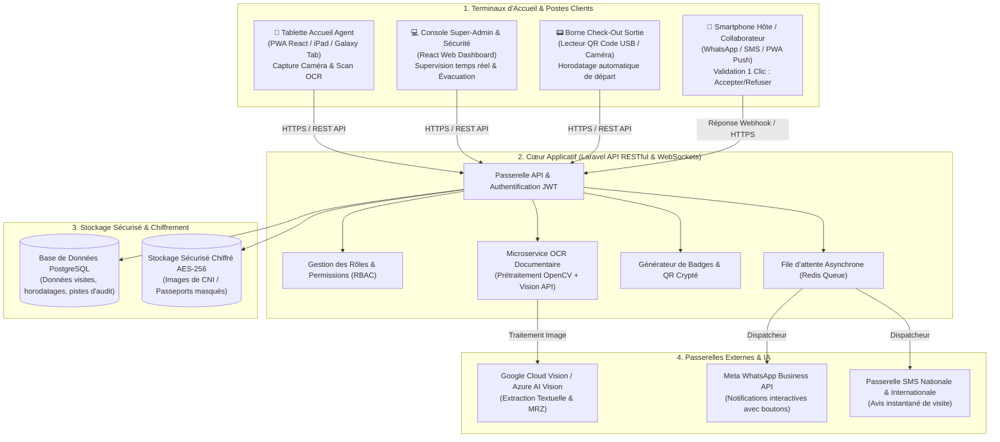
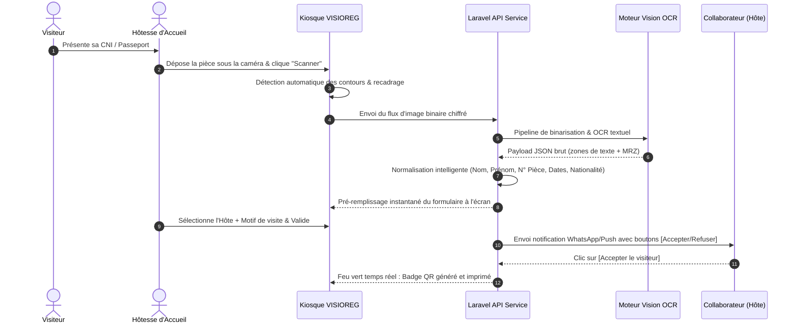

# SPÉCIFICATIONS & ARCHITECTURE TECHNIQUE
# VISIOREG™ — Système Intelligent de Gestion des Visiteurs & Contrôle d'Accès

> **Plateforme Intelligente Multi-Terminaux (Tablette / Web / Mobile) & Backend Laravel API**  
> **Conception & Ingénierie :** SERI TAGRO ROY  

---

## 1. Schéma Directeur de l'Architecture Système



---

## 2. Pipeline d'Intelligence Artificielle OCR Documentaire

L'extraction des informations des pièces d'identité repose sur un pipeline en 5 étapes garantissant une précision supérieure à **99.4%** en moins de **1.8 seconde** :



---

## 3. Schéma Relationnel de la Base de Données (PostgreSQL)

```sql
-- 1. Table des Visiteurs (Fiches d'identité uniques)
CREATE TABLE visitors (
    id UUID PRIMARY KEY DEFAULT gen_random_uuid(),
    first_name VARCHAR(100) NOT NULL,
    last_name VARCHAR(100) NOT NULL,
    document_type VARCHAR(30) NOT NULL, -- 'CNI', 'PASSPORT', 'DRIVING_LICENSE'
    document_number VARCHAR(80) UNIQUE NOT NULL,
    document_expiry_date DATE,
    birth_date DATE,
    nationality VARCHAR(80) DEFAULT 'Ivoirienne',
    phone_number VARCHAR(30),
    email VARCHAR(150),
    company VARCHAR(120),
    photo_url TEXT,
    document_scan_url TEXT, -- Chiffré au repos
    is_blacklisted BOOLEAN DEFAULT FALSE,
    blacklist_reason TEXT,
    created_at TIMESTAMP WITH TIME ZONE DEFAULT NOW(),
    updated_at TIMESTAMP WITH TIME ZONE DEFAULT NOW()
);

-- 2. Table des Collaborateurs Internes (Hôtes & Employés)
CREATE TABLE employees (
    id UUID PRIMARY KEY DEFAULT gen_random_uuid(),
    full_name VARCHAR(150) NOT NULL,
    department VARCHAR(80) NOT NULL, -- 'Direction Générale', 'DAF', 'Ressources Humaines', 'IT', etc.
    job_title VARCHAR(100),
    email VARCHAR(150) UNIQUE NOT NULL,
    phone_number VARCHAR(30) NOT NULL,
    office_number VARCHAR(40),
    whatsapp_enabled BOOLEAN DEFAULT TRUE,
    created_at TIMESTAMP WITH TIME ZONE DEFAULT NOW()
);

-- 3. Table des Visites & Registre d'Accès
CREATE TABLE visits (
    id UUID PRIMARY KEY DEFAULT gen_random_uuid(),
    visit_code VARCHAR(20) UNIQUE NOT NULL, -- Code unique court ex: VIS-8924
    visitor_id UUID NOT NULL REFERENCES visitors(id) ON DELETE CASCADE,
    employee_id UUID NOT NULL REFERENCES employees(id),
    visit_purpose VARCHAR(150) NOT NULL, -- 'Rendez-vous professionnel', 'Livraison', 'Entretien', etc.
    status VARCHAR(30) DEFAULT 'PENDING_APPROVAL', -- 'PENDING', 'APPROVED', 'REJECTED', 'ACTIVE_INSIDE', 'COMPLETED'
    check_in_time TIMESTAMP WITH TIME ZONE,
    check_out_time TIMESTAMP WITH TIME ZONE,
    duration_minutes INTEGER,
    badge_code VARCHAR(100) UNIQUE,
    badge_qr_payload TEXT,
    rejection_reason TEXT,
    registered_by_user_id UUID, -- ID de l'agent d'accueil
    created_at TIMESTAMP WITH TIME ZONE DEFAULT NOW()
);

-- 4. Pistes d'Audit & Journal de Sécurité
CREATE TABLE access_logs (
    id BIGSERIAL PRIMARY KEY,
    visit_id UUID REFERENCES visits(id),
    action VARCHAR(50) NOT NULL, -- 'CHECK_IN', 'CHECK_OUT', 'HOST_NOTIFIED', 'BADGE_PRINTED'
    performed_by VARCHAR(100),
    ip_address VARCHAR(45),
    device_info TEXT,
    timestamp TIMESTAMP WITH TIME ZONE DEFAULT NOW()
);
```

---

## 4. Matrice des Rôles & Sécurité (RBAC)

| Rôle | Droits d'Accès Principaux | Terminaux Assignés |
| :--- | :--- | :--- |
| **Agent d'Accueil / Réceptionniste** | Enregistrement de visiteurs, scan OCR, émission de badges, validation des départs. Pas d'accès aux paramètres système. | Kiosque Tablette / PC d'accueil |
| **Collaborateur / Employé (Hôte)** | Réception des alertes visiteurs le concernant, validation/refus d'accès, historique personnel de ses réceptions. | Smartphone (WhatsApp / Email / App) |
| **Direction Générale / DAF** | Consultation de l'ensemble des rapports d'affluence, validation VIP prioritaire, métriques de fréquentation. | PC de bureau / Mobile |
| **Responsable de la Sécurité (HSE)** | Vue en direct de toutes les personnes dans le bâtiment, déclenchement du protocole d'évacuation, gestion de la liste noire. | Tablette de surveillance / PC PC Sécurité |
| **Super-Administrateur IT** | Gestion des comptes utilisateurs, configuration des API WhatsApp/OCR, sauvegardes et journal d'audit. | Console Web sécurisée |

---

## 5. Protection des Données Personnelles & Conformité Légale

La solution respecte scrupuleusement la loi ivoirienne n° 2013-450 relative à la protection des données à caractère personnel (contrôlée par l'**ARTCI**) et les standards internationaux (RGPD) :

1. **Minimisation des Données :** Seules les informations strictement requises pour le contrôle d'accès sont collectées.
2. **Chiffrement au Repos & en Transit :** Toutes les photographies de pièces d'identité sont stockées sous format chiffré **AES-256 bits** avec des clés renouvelées.
3. **Purge Automatique Paramétrable :** Les images des pièces d'identité peuvent être automatiquement supprimées après une durée légale paramétrable (ex: 30 jours, 60 jours ou 90 jours), en ne conservant que l'horodatage textuel de la visite.
4. **Non-Divulgation Visuelle :** À l'inverse d'un registre papier où chaque visiteur peut lire les coordonnées des visiteurs précédents, l'écran de l'agent se réinitialise immédiatement après chaque enregistrement.

---

**Conception Technique :** SERI TAGRO ROY  
*Spécifications approuvées pour implémentation logicielle.*
